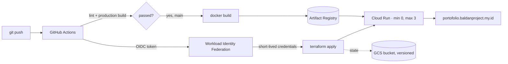

# baldanportofolio

Source of **[portofolio.baldanproject.my.id](https://portofolio.baldanproject.my.id)**, the portfolio of N.I.S. Baldanullah, Full Stack Data Scientist: 30+ live machine-learning and deep-learning demos, five analytics dashboards, and how-it-works pages for production systems.

[](https://github.com/baldan555/baldanportofolio/actions/workflows/ci-cd.yml)

## What's inside

| Area | Where |
|---|---|
| Landing page, work case studies (`/work/*`) | `src/app`, `src/components` |
| Skill hubs: ML, deep learning, analytics & BI, data engineering, web/SaaS/mobile, automation & AI agents | `src/app/skills` |
| Models trained offline, exported to JSON and run in the browser | `ml/*.py` → `src/data/models/*.json` |
| Analytics dashboards (incl. an FWA customer-base case built from synthetic raw data) | `ml/*_dashboard.py`, `ml/fwa_*.py` → `src/data/*.json` |
| CV in six country formats (International, US, UK, Australia, Europass, Indonesia) | `docs/cv` → `public/cv` |
| Infrastructure as code | `infra/` |
| Pipeline | `.github/workflows/ci-cd.yml` |

**Stack:** Next.js 16 (App Router, Turbopack, Cache Components), React 19, TypeScript, Tailwind CSS 4, framer-motion · Python, pandas, scikit-learn, TensorFlow · Docker, Google Cloud Run, Artifact Registry, Terraform, GitHub Actions · Google Analytics 4.

## Architecture



## CI/CD

One workflow, [`ci-cd.yml`](.github/workflows/ci-cd.yml):

- **Every push and pull request:** `npm ci`, ESLint, and a full production build (type-checks and prerenders all pages), plus `terraform fmt -check` and `terraform validate`.
- **Pull requests:** `terraform plan` against the real state, so infrastructure changes are reviewed before merge.
- **Push to `main`:** builds the Docker image (layer cache in GitHub Actions), pushes it to Artifact Registry tagged with the commit SHA, rolls it out with `terraform apply`, then smoke-tests the live domain and checks that the new image is the one serving.

There are **no stored cloud keys**: GitHub's OIDC token is exchanged for short-lived credentials through Workload Identity Federation, trusted for this repository only. The deployer identity can manage only this site's Cloud Run service, its image repository and the Terraform state bucket.

## Infrastructure

[`infra/terraform`](infra/terraform) manages:

- **Artifact Registry** repository, with a cleanup policy (keep the 10 newest images, delete the rest after 30 days).
- **Cloud Run** service: Next.js standalone server, 1 vCPU / 1 GiB, startup CPU boost, **scales to zero** (min 0, max 3 instances), deletion protection on.
- **Public access** (`roles/run.invoker` for `allUsers`).

The resources were first created by hand, so [`imports.tf`](infra/terraform/imports.tf) adopts them into state instead of recreating them. State is kept in a private, versioned GCS bucket. [`infra/bootstrap.sh`](infra/bootstrap.sh) is the one-time setup (state bucket, deployer service account, Workload Identity pool and provider). The custom domain is a Cloud Run domain mapping that routes to the service by name and is left outside Terraform on purpose.

## Run locally

```bash
npm ci
npm run dev        # http://localhost:3000
npm run build      # production build, same as CI
```

Retrain a model or rebuild dashboard data (Python 3.12, `ml/.venv`), for example:

```bash
python ml/train.py
python ml/fwa_generate.py && python ml/fwa_analyse.py
```

Rebuild the CV PDFs after editing `docs/cv/data.mjs` or `docs/cv/cv.html`:

```bash
node docs/cv/build.mjs
```

## Data and privacy

Raw datasets and the Python environment stay out of the repository; only the scripts and the small JSON files the site reads are committed. Demo screenshots use made-up data. Analytics (GA4) loads only in production builds.
